# Who's walking? How to run it

Uzayr's EEE4022S final-year project demo for UCT Open Day (18 November 2026). Two ESP32 boards and Wi-Fi channel
state information (no camera) tell a visitor's walk from Uzayr's, and show the walking speed. How it works: [What it
is](#what-it-is).

This is the guide for Open Day and for the tests at home. You start the app with one command, and after that
everything is done with the wireless mouse. The big button at the bottom right never moves, so leave the pointer on
it and click from the back mark. **The bright button is always the next step.**

The big card at the bottom of the screen is for the visitors. Your instructions are the line to the left of the
buttons, and the light at the top warns you when something needs you (section 5).

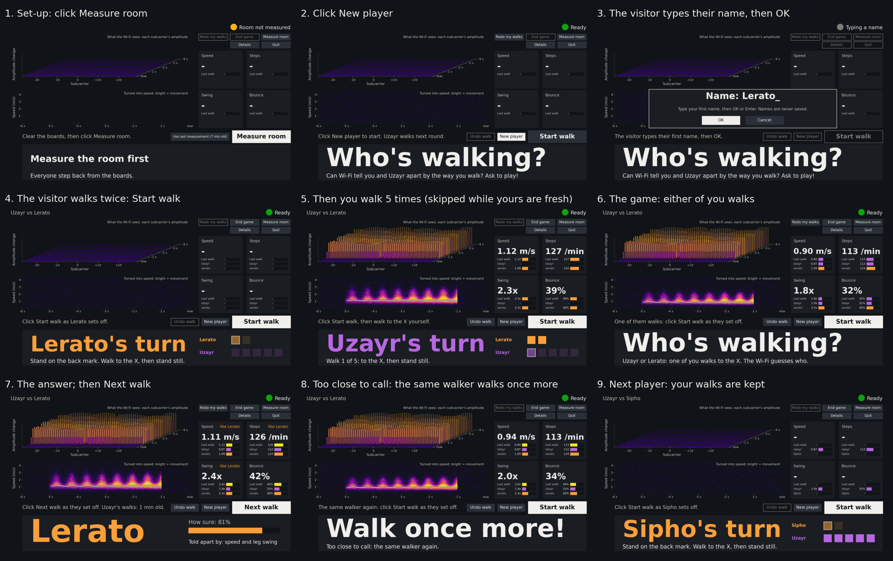

**What this folder needs.** This repo holds the app only. It runs on Uzayr's MacBook with Anaconda's Python
(`/opt/anaconda3`, with numpy, scipy, matplotlib, pyyaml, pyserial and pytest). Running it live or on a replay
needs the private thesis code next to it in `../Code`. The trained model, the recordings and the list that joins
participant codes to names stay on the laptop ([Files](#files)); without the model the app uses a simpler rule,
the nearest centre (m0). Without the boards and `../Code` you can still run the tests and `screens` ([Other
commands](#other-commands-run-from-this-folder)).

## 1. Set up the bench

```
      wall
   [TX] <-0.5 m-> [RX2]    [laptop]     on the workbench: the boards right beside the laptop
          |
          |  about 30 cm
          X                STOP HERE and stand still        (taped X, A4 sign)
          |
          |  at least 3 m (3.2 m worked at home); as far back as the room allows
          |
          o                START HERE: the back mark        (the walker starts here; you stand here too)
```

- **The two marks.** A taped **X** about 30 cm in front of the boards, and a **back mark** at least 3 m behind
  the X. Everyone uses the same two marks all session. Nothing is measured or typed in, and the screen never
  mentions metres.
- **The boards.** Back to a wall or a corner if you can. During a walk nobody but the walker comes within about
  3 m of them: the crowd watches from further back (tape a line at 3 m if you can). A hand 0.7 m from the boards
  outshouts a person 3 m away.
- **The laptop sits beside the boards,** so nobody stands at the laptop during a walk. You stand on the back
  mark with the mouse. Visitors type their name only between walks. If someone has to stay at the laptop, they
  keep still until the walk is over.
- **TX:** on a wall charger. If it's on the Mac's USB as well, that's fine: the app finds the receiver by itself.
- **RX2:** on USB to the Mac, with the cable that worked on 6 Nov. A bad cable shows up as "No signal".
- **The screen:** the MacBook's own screen, facing the visitors (no second monitor). Before the day, stand on the
  back mark at home and check you can read your line beside the buttons and the light at the top. If you can't,
  stay on the back mark during walks anyway (never within 3 m of the boards): the light's colour and the bright
  big button are enough to work from, and you can step closer between walks.
- **The mouse pointer:** make it bigger so you can find it from the back mark: **System Settings >
  Accessibility > Display > Pointer size**.
- **Measure the room once, at set-up, while the hall is still empty** (section 3, step 1). The app keeps that
  room level all day, also when you restart it, so a busy hall later can't spoil it.

**What the walker hears (say it aloud):** "Stand on START. When I say go, walk to the X and stand still on it
until the answer appears. Then walk back." And for the round: "You walk twice so it learns your walk, then I walk
five times if it needs me, then we play: it guesses which of us is walking. If it's too close to call, the same
person walks once more."

## 2. Start the app (one command)

In VS Code, open a terminal (**Terminal > New Terminal**; it opens in this folder), then type:

```
./run_openday.command
```

Or double-click **`run_openday.command`** in Finder. The app opens full screen about 10 seconds later. Click it
once. The launcher keeps the Mac awake while the app runs.

If the terminal is in another folder, type `cd ~/Desktop/UNI/2026/EEE4022S/OpenDay` first.

To stop the app, click **Quit** (top right), then **Yes, quit**.

## 3. A round, step by step

| Step | The screen | You click | What happens |
|---|---|---|---|
| 1 | 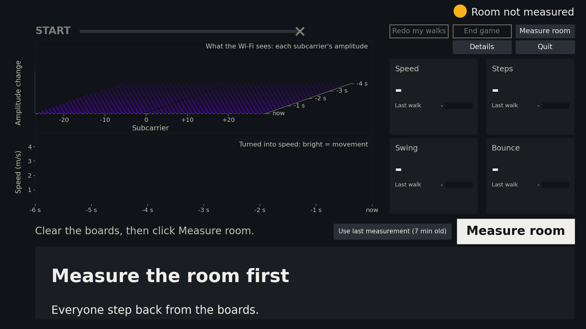 | **Measure room** | Stand on the back mark first. The app gives everyone 5 s to step back, then measures the empty room for 30 s ("Hold still"). Then it shows "Who's walking?". Do this once, at set-up, while the hall is empty: the app keeps this room level all day. After a restart, click **Use last measurement** instead (it shows whenever the room was measured cleanly earlier today). |
| 2 | 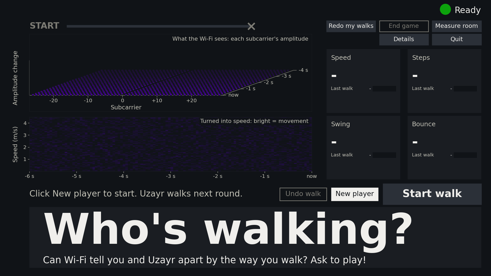 | **New player** | Opens the name box. (**Start walk** here gives a speed-only walk: "1.05 m/s, your walking speed".) |
| 3 | 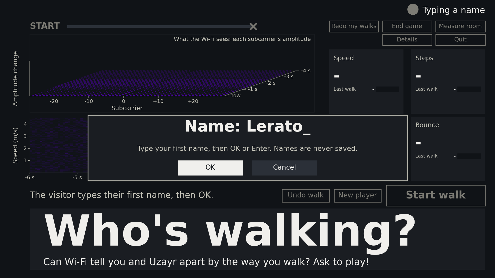 | the visitor types, then **OK** | Their first name, then OK or Enter. No name gives "Guest". Names are never saved. **Cancel** goes back. |
| 4 | 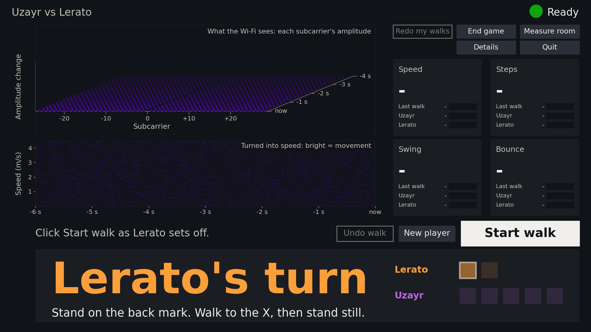 | **Start walk**, twice | The visitor walks first, twice. The card says whose turn it is, and the dots fill in (top row them, bottom row you). After the first walk: "Got it! Once more."; after the second: "Got it! Now Uzayr walks 5 times." (or the game, when your walks are kept). Nothing else to click: each walk goes to whoever's turn it was. If the wrong person walked, click **Undo walk** and that turn is walked again. |
| 5 | 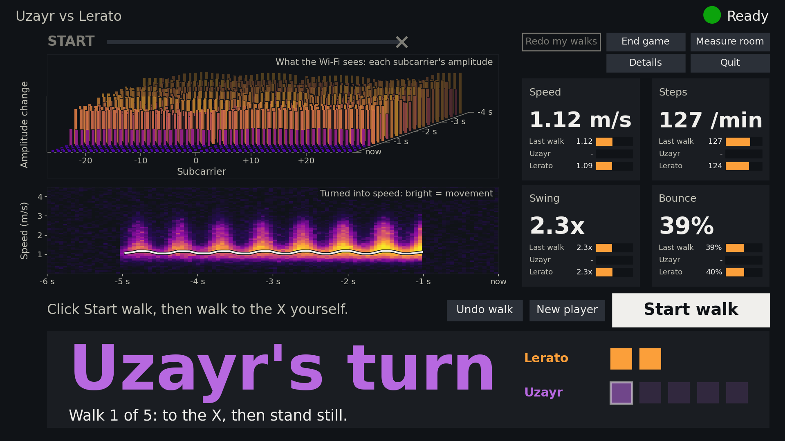 | **Start walk**, 5 times (you walk) | Then your five walks: click **Start walk** and walk to the X yourself. The card counts them ("Walk 3 of 5: to the X, then stand still."), and your row has five dots. **Skipped** when your walks from an earlier round are under 25 minutes old (below): then the game starts right after the visitor's two walks ([picture](reports/screens/28_reuse_learning.png): your row of dots is already full). |
| 6 | 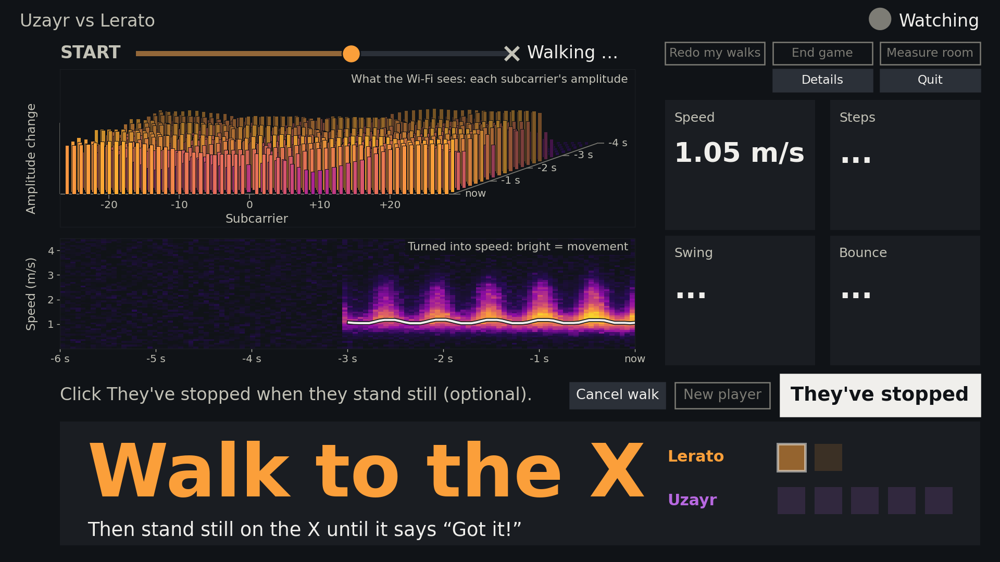 | nothing (or **They've stopped**) | The walker goes to the X and stands still. The lane above the pictures shows them on their way, from START to the X, and says "On the X" when the walk ends ([The screen](#the-screen)). The walk ends by itself under two seconds after they stop. You can click **They've stopped** once they stand on the X. Do so for every walker when people move nearby ([Your routine at the stand](#your-routine-at-the-stand)); otherwise you don't need to. A click that comes after the walk has already ended does nothing: the big button stays grey for 3 s after every walk. |
| 7 | 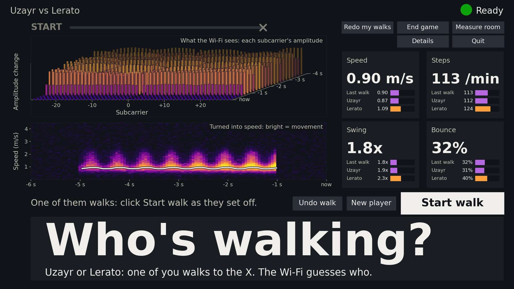 | **Start walk** | After the last learning walk: "Got you both! Now the guessing game." (or "Got it! Now the guessing game." when your walks were kept). You **or** the visitor walks; the crowd can choose. |
| 8 | 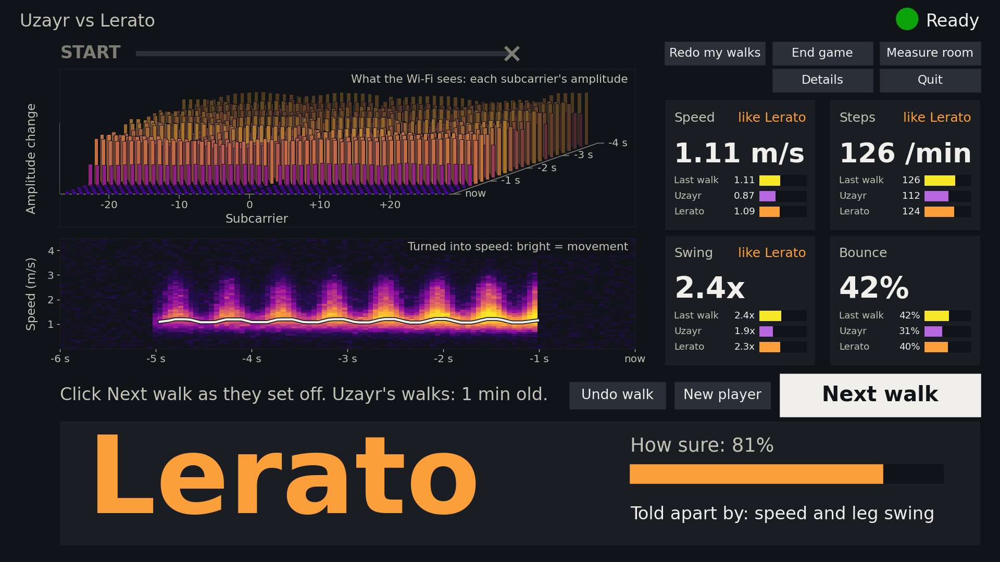 | **Next walk** | Under two seconds after they stop: who it was, "How sure", and what told you apart ("Told apart by: speed and leg swing"). The tiles say which person each reading was "like". Nothing to click but **Next walk**: the visitors can see for themselves whether the guess was right. There is no score on screen. |
| 9 | 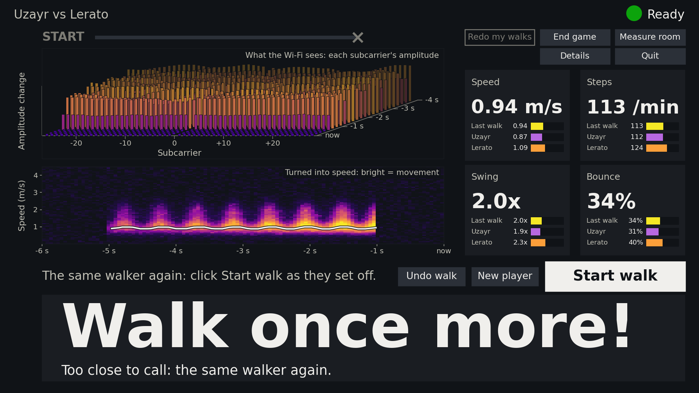 | **Start walk** | A close call names nobody yet: "Walk once more!" ("Too close to call: the same walker again."). The **same** person walks again from the back mark (on the thesis people about 1 game walk in 6 (16 %); in the home tests about 1 in 4, and 1 in 2 in a disturbed room). |
| 10 | 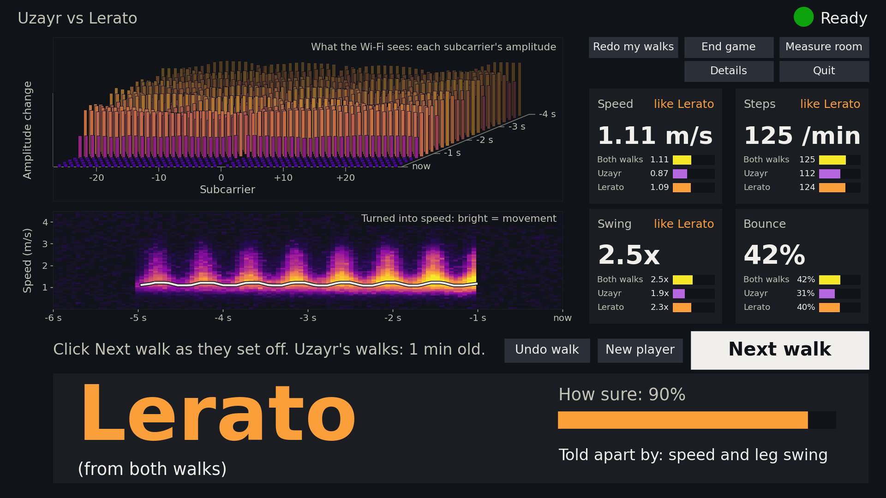 | **Next walk** | The answer from both walks together, marked "(from both walks)"; the tiles show what it was decided on, both walks' readings averaged (the row "Both walks"). It never asks a third time: if it is still close, it names the nearer person with a lower "How sure" ([picture](reports/screens/19_close_call.png)). If the second walk is missed, the first walk's answer shows. |

When the visitor is done, **New player** starts the next one: the name box, then their two walks (and your five, if
yours are 25 minutes old or more). The last visitor's name and walks are wiped. **End game** (top right) wipes them without
starting a new player. It asks first: **Yes, end it** or **Keep going**.

**One walk.** Say "go" and click **Start walk** as you say it: the walker leaves the back mark on "go", while you
stand there too. They walk to the X and **stand still** on it. Only one person walks at a time, and nobody else
goes near the boards. Then they walk back to the start.

**Your walks are kept for 25 minutes,** so most rounds are just the visitor's two walks, then the game.

- **When they are used.** After you walk your five learning walks, the app keeps them, in memory only (never on
  disk). A new player gets them if they are under 25 minutes old when you click **New player**; a game already
  running keeps using them to its end.
- **When they expire.** 25 minutes after you walked them, when the app takes a new room level (**Measure room**
  found the room clearly quieter than earlier today), and when the app restarts. The next round then asks for your five
  walks again, after the visitor's. **Why: the room changes** (the crowd, doors, bags near the boards, a new room
  measurement), so old walks stop matching your walks now. At home, walks up to 27 minutes old within one app run
  still matched as well as new ones; walks from another run or day did not.
- **What you see.** Between walks your line says how old they are ("Uzayr's walks: 6 min old.") or "Uzayr walks
  next round." ([picture](reports/screens/30_walks_expire_soon.png)). The light stays green: it is only about the
  room and the signal.
- **Walk ahead.** Walks from the morning don't work, but walks from a few minutes ago do. So when nobody is
  playing (no queue, or while the next visitor gets ready), click **Redo my walks** and walk your five: for the next
  25 minutes each player only walks twice, and you just click for them from the back mark.
- **Redo my walks** (top right) works between walks when nobody is learning: with no player, in the game, or on
  an answer. It is dim while someone is learning or walking, and with "No signal". Your five turns, then the game
  carries on ([picture](reports/screens/31_redo_my_walks.png)). Clicked it by mistake? **Undo walk** brings your
  old walks back, until you walk (your line says so: "Undo walk keeps the old ones.").
- The game walks never change what it learned: it always compares with those learning walks (the visitor's 2,
  your 5). Why 5 for you: your walks are kept, so the extra three cost time only once every 25 minutes, and more
  of them make your side steadier.
- **Too close to call.** The card waits for the second walk: **Measure room** (even if it fails), a lost signal,
  **New player** then **Cancel**, and **Keep going** in the Quit or End game box all come back to it; **Undo walk**
  drops it (back to the game, nobody named), and so do **End game**, a new player and **Quit**. To switch "Walk
  once more!" off: `second_look: false` in `configs/openday.yaml` (`classifier:`).

**How long a round takes** (about 20 s per walk, there and back): the name and the visitor's two walks about
1 minute, your five walks another 100 s when they are due (once every 25 minutes), then the game (about 20 s a
walk, and one more for a close call).

### Your routine at the stand

- **Before visitors arrive.** Click **Details**: about 150 pkt/s on the bottom line (the light goes red under 100).
  Click **Details** again. Then **Measure room**, while the hall is still empty. The app keeps that room level all
  day, through restarts too.
- **Crowd line at 3 m** from the boards. Someone moving 2 m away can be as loud to the app as the walker on the X.
  At 3 m they are much weaker, but a crowd moving there can still turn the light amber ("Wait for green"): ask
  them to keep still or step back. If nobody is inside the line, start the walk anyway, and click **They've
  stopped** as the walker lands.
- **Don't measure the room again unless it is quiet** (nobody within 3 m moving). You don't need to: the app
  keeps today's room level, and a new measurement replaces it only if it is clearly quieter (a tenth or more).
  Then your line says "Quieter than earlier: room level ...", and your kept walks expire (the next round asks for
  your five again). Otherwise the app keeps today's level and says so in green: "Busier than earlier: kept the
  earlier room level ..." (or "About the same as earlier: ...", or "Someone moved: ..."). That means nothing to
  do: the app carries on with today's level, and your kept walks stay.
- **Light stays amber with nobody moving anywhere, even after Measure room?** Do as for [moved
  boards](#if-you-move-the-boards).
- **After a restart,** click **Use last measurement**: it takes today's room level. (**Measure room** works too,
  but only a clearly quieter room replaces today's level.)
- **If you move the boards,** today's level no longer fits: see section 6, [If you move the
  boards](#if-you-move-the-boards).
- **One warm-up walk first.** Your first walk or two of a session often came out odd at home. On "Who's walking?"
  with no player, **Start walk** gives a walk that counts for nothing. Then **Redo my walks** and walk your five.
- **Click They've stopped as the walker lands on the X** whenever people are moving nearby: a busy room rarely
  makes the app miss a walk, but it can make walks end late, or see a walk that wasn't there.
- **Say "go" and click as you say it.** The walker leaves on "go". The same for every walk, yours too.

### What the card says

These replace the bottom line of the card for a few seconds. The big text and the dots stay.

| The card says | When | What to do |
|---|---|---|
| [Got it! Once more.](reports/screens/08_notice_got_it.png) (green) | A first learning walk was seen (the visitor's, or yours). | The same person walks again. |
| [Got it! Now Uzayr walks 5 times.](reports/screens/32_notice_now_uzayr_walks.png) (green) | The visitor's second walk was seen, and your walks are due. | Your five turns. |
| Got it! 4 more walks. (green) | One of your learning walks was seen ("Once more." before your last). | Walk again. |
| [Got you both! Now the guessing game.](reports/screens/13_notice_got_you_both.png) (green) | Your last learning walk was seen. | Start the game. |
| [Got it! Now the guessing game.](reports/screens/29_notice_reuse_got_it.png) (green) | The visitor's last walk was seen, and your walks were kept from before. | Start the game. |
| [Got it! Back to the game.](reports/screens/34_notice_redo_back_to_game.png) (green) | After **Redo my walks** in a game: your last walk was seen. | Carry on with the game. |
| [Got it! Ready for the next player.](reports/screens/35_notice_redo_next_player.png) (green) | After **Redo my walks** with no player. | **New player** when the next visitor is ready. |
| [Back to the game.](reports/screens/33_notice_redo_undone.png) (green) | **Undo walk** right after **Redo my walks**: your old walks are kept. | Carry on with the game. |
| [Missed that one. Same turn again: start from the back mark.](reports/screens/10_notice_missed.png) (amber) | The app didn't see a walk: under 1.5 s of movement. It gives up 5 s after the click if almost nothing moved. | Walk again from the back mark, and click as they set off. |
| [Walk cancelled.](reports/screens/12_notice_walk_cancelled.png) (amber) | You clicked **Cancel walk**. | Walk again (in learning, the same turn). During a second look it says "Walk cancelled. Same walker again." and goes back to "walk once more". |
| Missed that one. The answer is from the first walk. (amber) | The second walk after "Walk once more!" wasn't seen. | Nothing: the first walk's answer shows. **Next walk**. |
| Both walks removed. (amber) | **Undo walk** on an answer "(from both walks)". | Walk again. |
| [Last walk removed.](reports/screens/11_notice_last_walk_removed.png) (amber) | You clicked **Undo walk**. | In learning, the same turn again. |
| [Lost the signal. Walk again when the light is green.](reports/screens/20_notice_lost_signal.png) (red) | The receiver stopped or restarted during a walk. | See section 6 if it happens again. |

## 4. The buttons

The big button is the only one you need during a round. It changes its name, never its place:

| Big button | When | What it does |
|---|---|---|
| **Measure room** | Set-up | 5 s to step back, then measures the empty room for 30 s |
| **Start walk** | Someone is on the back mark | Starts a walk |
| **They've stopped** | During a walk (from 1.5 s after the start) | The walker stands on the X: ends the walk now. When people move nearby; otherwise optional |
| **Next walk** | After an answer | Starts the next walk |

For 3 s after a walk ends the big button is grey: a late **They've stopped** click can't start a walk nobody
meant, or hide the answer. If you click it then, your line says "Ignored: that walk had already ended by itself."

The small buttons sit in fixed places: **Undo walk** and **New player** left of the big button, and two rows at
the top right, over the tiles: **Redo my walks** · **End game** · **Measure room**, and under them **Details** ·
**Quit**.

| Small button | What it does |
|---|---|
| **Undo walk** | Throws away the last walk. In learning (yours too), that turn is walked again. During a walk it reads **Cancel walk**. Right after **Redo my walks**, before you walk: keeps your old walks. On "Walk once more!": throws that walk away (back to the game, nobody named). On an answer "(from both walks)": throws both walks away. |
| **New player** | The name box, then the visitor's two walks, then your five if yours are due (25 minutes old or more). |
| **Use last measurement** | Set-up only (where Undo walk and New player sit later): takes today's room level, measured cleanly earlier today (also before a restart). Click it after every restart. |
| **Redo my walks** | Between walks (no player, in a game, or on an answer): your five learning walks again now, without a new player ("Uzayr's turn"; the card says "Uzayr walks 5 times, then the game carries on."). Then the game carries on, and the next players use these walks. With no player it is the way to walk ahead. Dim while someone is learning or walking, on "Walk once more!", and with "No signal". By mistake? **Undo walk** before you walk keeps the old ones. |
| **End game** | Asks first, then wipes the player and goes back to "Who's walking?". Your walks are kept. |
| **Measure room** | Measures the room again: 5 s to step back, then 30 s still. Only a clearly quieter room (a tenth or more) replaces today's level ("Quieter than earlier"): then your kept walks expire (the next round asks for them again), and if you clicked it part-way through your learning walks, you walk all five again straight after. Otherwise your line says "kept the earlier room level" (green) and nothing changes. On "Walk once more!" it comes back to that card afterwards (even if measuring fails): the second walk is still to come. |
| **Details** | Shows the packet rate, the room level and how old your walks are on the bottom line. |
| **Quit** | Asks first ("Yes, quit"), then the player is wiped and the app closes. |

A button drawn as an outline with dim text can't act at that moment (a working button is filled); the buttons
never move. A double-click never does two things: a second click on the same small button within
a moment is ignored, and so is a second click on the big button just after a walk starts (1.5 s) or ends (3 s).
The app opens full screen; Ctrl+F switches that off and on (off: a smaller window that fits on the MacBook's
screen).

**Keyboard (optional).** Space, Right, Down or PageDown = the big button. Backspace = Undo walk / Cancel walk.
Left or PageUp (the clicker's back key) cancel a walk, redo a learning turn, or right after **Redo my walks**
keep your old walks; they never throw away an answer. N = New player, Enter = OK (or Use last measurement),
Ctrl+N then Y = End game, Ctrl+U = Redo my walks (again, before you walk: keeps the old ones), Ctrl+B = Measure
room, Ctrl+F = full screen, Ctrl+D = Details,
Ctrl+Q then Y = Quit.

## 5. The light

The light in the top-right corner answers one question: can the next walk start? It never stops you from clicking
Start walk.

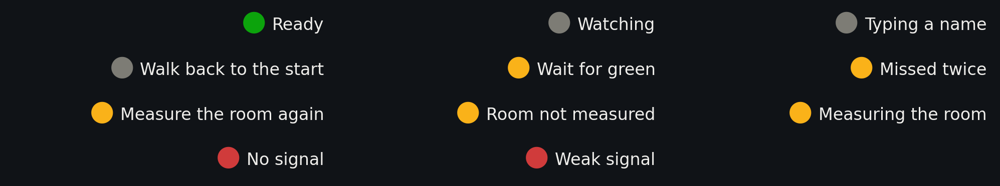

| Light | Meaning |
|---|---|
| **Green** "Ready" | Go. |
| **Grey** "Watching" | A walk is under way. |
| **Grey** "Typing a name" | The name box is open. |
| **Grey** "Walk back to the start" | Just after a walk: the walker is going back (for 3 s the big button is grey too). |
| **Amber** "Wait for green" | Someone has been moving near the boards for 3 s. Ask them to step back. |
| **Amber** "Missed twice" | Two walks in a row weren't seen. Is someone near the boards? Is the walker starting from the back mark? It goes when a walk is seen, or with the next player. |
| **Amber** "Measure the room again" | Someone moved while the room was measured, and there is no clean measurement yet today (20 s; the app uses the still part of it until you measure again). Everyone still, then **Measure room** (top right). Once the room has been measured cleanly today, it never asks again. (In a test recording also when the room was busier than earlier in the run, 15 s.) |
| **Amber** "Room not measured" / "Measuring the room" | Set-up. |
| **Red** "No signal" / "Weak signal" | A problem with the boards or the cable only (section 6). |

## 6. When something goes wrong

| Problem | Do this |
|---|---|
| The terminal says "No receiver found" | RX2 isn't on USB. Plug it in and start the app again. |
| The terminal says "none of them is sending CSI" | The TX has no power, or the RX2 cable is bad. Check the TX charger; swap the RX2 cable. |
| Red light "No signal", and "Receiver silent" on the left ([picture](reports/screens/23_no_signal.png)) | Check the TX charger and the RX2 cable. A replugged receiver needs a restart: **Quit**, **Yes, quit**, then start the app again. |
| Red light "Weak signal" | Fewer than 100 packets a second reach the laptop (Details shows about 150 when all is well). Check the RX2 cable and socket. |
| "Missed that one" keeps appearing | Start each walk from the back mark, click as the walker sets off, and keep everyone else away from the boards. After two misses in a row the light says "Missed twice". |
| The light stays on "Wait for green" | Ask people near the boards to step back. Nobody within 3 m, but people moving further back? Start the walk anyway, and click **They've stopped** as the walker lands. Nobody moving anywhere at all, and it stays amber? Something near the boards changed: [If you move the boards](#if-you-move-the-boards). |
| The light says "Measure the room again" ("Someone moved" on your line) | Someone moved while the room was measured, and today has no clean measurement yet: **Measure room** (top right) again, everyone still. |
| Your line says "Busier than earlier", "About the same as earlier" or "Someone moved: kept the earlier room level" | Nothing to do: that measurement wasn't clearly quieter than today's, so the app kept today's level (and your walks). |
| You clicked **They've stopped** but the walk had already ended | Nothing happens (your line says "Ignored"): the big button is grey for 3 s after each walk. Click again as the next walker sets off. |
| The answer is slow, or a walk runs on to 9 s | Click **They've stopped** as soon as the walker stands still on the X. |
| The answer came while they were still walking | The walk ended early. Click **Undo walk** and walk again. |
| The wrong person walked a learning turn | Click **Undo walk**: that turn is walked again, by the right person. |
| You think your walks went wrong, or the room changed a lot | Click **Redo my walks** between walks: your five walks again. |
| "Walk once more!" but the other person walks next by mistake | Click **Undo walk** on the answer: both walks go. Then walk again. |
| You clicked **Redo my walks** by mistake | Click **Undo walk** before you walk: your old walks come back and the game carries on. |
| A name was typed wrong | **Cancel** in the name box, or **New player** again later (the turns start again). |
| The app is frozen | Click in the VS Code terminal and press Ctrl+C (or Cmd+Option+Esc, Python, Force Quit). Start it again (about 10 s), then **Use last measurement**. Then **New player** again: the visitor walks twice and you five times again (your kept walks go with a restart). |

### If you move the boards

The app keeps today's room level, through restarts too. Once the boards (TX or RX2) have moved, that level is
wrong, so make the app forget it:

1. **Quit**, **Yes, quit**.
2. In the VS Code terminal type `./run_openday.command --new-room` (it forgets today's room level).
3. **Measure room**, with nobody within 3 m moving. This is the new level for the rest of the day.

## 7. Solo test at home

This is the same app as on the day, plus the red RECORDING box at the top (the raw radio data is saved so it can be
checked afterwards; no names are recorded) and optional It was buttons on answers. Every button you use on the
day is in the same place. Learning needs no clicks, as on the day: each walk goes to whoever's turn it was
([picture](reports/screens/24_recording_learning.png)).

Only in a recording, an answer also shows **It was** *name* and **It was Uzayr**, left of **Undo walk**
([picture](reports/screens/25_recording_answer.png)), and a speed-only walk **It was Uzayr**
([picture](reports/screens/27_recording_speed.png)). They are optional and change nothing in the game: a click
only notes who really walked, so the recording can be scored afterwards ("Thanks: that was Lerato."). One click
per walk is final: both buttons go dim, the one you clicked gets a tick
([picture](reports/screens/26_recording_noted.png)), and another click only says "Already noted". A wrong click?
**Undo walk** removes that walk. On the day there are no It was buttons at all.

1. Set up as in section 1 and measure the distance from the back mark to the X. Then, in the VS Code terminal:

   ```
   ./run_solo_test.command
   ```

   (or double-click it in Finder). The terminal prints the folder it records into, e.g.
   `bench/solo_20261108/20261108-125235`.
2. Click **Details** (top right): about 150 pkt/s on the bottom line. Click **Details** again. Stand on the back
   mark and click **Measure room**: 5 s to step back, then 30 s still (as on the day; a recording always measures,
   and always uses its own measurement). Wait for "Who's walking?".
3. **Nobody walking:** from the back mark, click **Start walk** 5 times over 2 minutes, with nobody near the
   boards. Each one should say "Missed that one" after about 5 s. (After two in a row the light says "Missed
   twice"; that's expected here.) If a speed shows instead of "Missed that one", click **Undo walk** and write
   down which click it was.
4. **Timed walks:** 10 walks. For each: on the back mark click **Start
   walk** and go; walk to the X and stand still until your speed shows; click **It was Uzayr** (optional, but it
   lets the check compare that walk with your stopwatch); walk back. Someone with a phone stopwatch starts it as
   you leave the back mark and stops it as you stand still on the X. Write the times down in order.
5. Optional: a round with a friend. **New player**, the seven learning walks (just **Start walk**: your friend
   twice, then you five times), a few game walks; after each answer click **It was ...** for who really walked.
   On "Walk once more!" the same person walks once more; the **It was ...** click after the answer labels both
   walks.
   Optional, but it lets the recording be scored. Then **New player** again (within 25 minutes): only your friend
   walks, twice, and the game starts. Once, in a game, click **Redo my walks** and walk your five turns. (The
   recording notes which of your walks each round reused, so it can still be scored.)
6. **Quit**, **Yes, quit**.

**What to send back:** the folder name the terminal printed, the stopwatch times in order, the distance from the
back mark to the X, and anything that looked wrong (a walk that took long to answer, a "Missed that one" on a real
walk, the light going red). The recording and the log (`logs/openday_<date>.log`) stay on the laptop, where they
can be read directly.

**The two-person bench** (the only real test of telling two people apart): run
`PYTHONDONTWRITEBYTECODE=1 /opt/anaconda3/bin/python3 -m openday bench-checklist` and follow it.

---

# Reference (not needed at the stand)

## What it is

Two ESP32 boards, no camera. A visitor walks towards the boards twice, then Uzayr five times (his walks are kept
for 25 minutes, so usually only the visitor walks). A game walk that is too close to call is walked once more, and
the answer comes from both walks. After that, the screen tells them apart from the radio echo alone.
Every walk also gives a walking speed.

The decision model (`state/model/`, retrained 12 Nov, in use since 13 Nov) never saw Uzayr or any visitor: it
learned, from the six thesis participants only, how two walks of one person differ from walks of two different
people (the speaker-verification idea), using 9 measures of each walk: speed, leg swing (the Swing tile's reading
and two Doppler measures of leg against torso motion), movement strength (modulation depth, also without the
slowest motion, and subcarrier spread) and two measures of the body's echo across the subcarriers (how alike
nearby subcarriers move, and how much of the movement one pattern carries). It was trained on walks cut the way
the app cuts them (from the Start click to the arrival), with each recording's own offset removed. Tested the way
the app plays (2 + 2 learning walks in the same minutes, a forced choice, two people it never saw, leave two out):
about 89.5 % right from one walk, and about 92 % with "Walk once more!" (needed on about 1 game walk in 6). It does
not recognise strangers, and it does not work across days. Two people who walk very alike are hard to tell apart:
at home, Uzayr against one friend was close to a coin flip (about 55 %).

**How a walk ends.** A walk is one click to the moment the walker stops; the standing still before and after
is left out. It ends on the first of: "arrived" (the echo has peaked as the walker reached the X and stopped
climbing for 0.5 s: about half a second after they stop), "stopped" (0.5 s of quiet), "operator" (They've
stopped), "nothing" (5 s with almost no movement: Missed) or "limit" (9 s). After "arrived" the screen alone
waits a little longer, until the echo has made no new peak for 1 s (`walk.screen_hold_s`; at most 1.5 s more,
`walk.screen_max_extra_s`); the walk the model reads, and so its answer, stay the same. The run log gives each
walk's ending and its arrival time. On 12 stopwatch-timed home walks it found the stop within 0.27 s (middle
value), and its speed was within 0.06 m/s of distance ÷ time on average.

> **Visitor sign:** Two Wi-Fi boards. No camera, nothing on you. / Your body changes the radio echo as you
> walk: speed, step rate, swing. / Two walks to learn you, then it tells you apart from me.

## The screen

- **Top line:** "Uzayr vs *name*" at the left, the light in the top-right corner.
- **Two columns under it.** Left: the lane, then the two pictures, as large as the screen allows. Right: the small
  buttons in two rows (Redo my walks, End game, Measure room; then Details and Quit), and the four tiles under them.
- **Above the pictures: the lane** ([picture](reports/screens/15_walking_game.png)): where the walker is, from START
  (the back mark) to the X, as a dot on a track that fills in behind it, with a few words beside the X: "Walking …",
  "Nearly there", "On the X". Between walks only START, the track and the X show, dim. The dot is the Speed tile's
  reading added up from the click (the distance walked), over the distance from the back mark to the X
  (`lane.length_m` in `configs/openday.yaml`, 3.2 m). It moves only while the Wi-Fi sees someone moving, never goes
  back, slows down from three quarters of the way, and goes onto the X only when the walk ends; it fades out 3 s
  later. A missed walk, **Cancel walk**, **Undo walk** and a lost signal leave it at rest. The dot is in the colour
  of whose learning turn it is (the visitor's orange, Uzayr's purple), yellow in the game. It shows how far you have
  walked, not where you stand: halfway along it was about 0.6 m off on the home walks, it often waits 1 to 2 s on
  START while the walker is far from the boards and faint, and "On the X" comes about a second after the walker
  stops (sooner with **They've stopped**). It is only a picture: nothing in it reaches a walk or an answer, and
  `lane.show: false` takes it away.
- **Left, top:** "What the Wi-Fi sees: each subcarrier's amplitude": how much the Wi-Fi signal's amplitude wobbles
  on every subcarrier, drawn in 3D as one bar per subcarrier, a row of bars every 0.16 s for the last 4 s ("now" in
  front, "-4 s" at the back). Left to right is the subcarrier (-26 to +28, each a slightly different radio
  frequency; there is no bar at 0, because Wi-Fi leaves the middle subcarrier empty). When nobody moves, the bars
  lie flat, in dark purple. When someone walks, they stand up and change colour as they rise: purple, then pink and
  orange, and yellow for the tallest. A crowd moving near the boards makes them stand up too. Why a wobble and not
  the signal itself: a walk barely changes the signal's level (a few %), but it makes the signal flicker some 5-40
  times a second, and that flicker is what the speed picture below turns into speed. It is only a picture: nothing
  in it reaches a walk or an answer. `ui.ridge_s` sets how many seconds it keeps (4).
- **Left, below:** "Turned into speed" for the last 6 s, in the same colours as the bars: dark is a still room,
  and movement shows purple, then orange and yellow the stronger it is; higher means faster (m/s). The
  white line is the body's speed.
- **Right:** Speed, Steps (a minute), Swing (leg swing) and Bounce. Speed updates live during a walk. Afterwards each
  tile shows the last walk (while learning, in the colour of whose turn it was) against Uzayr's average and the
  visitor's, and which one it was "like". On an answer from both walks the tiles show both walks' readings averaged
  (the row "Both walks").
- **Buttons:** your instructions on the left, then the small buttons, then the big one (section 4).
- **Bottom card, for the crowd:** what to do ("Lerato's turn", "Walk to the X", with a small line under it), then
  the answer in the person's colour, "How sure" and what told the two apart. While learning, dots in two rows, the
  visitor's on top, then yours (filled = done, outlined = now, faint = still to come; yours already filled when your
  walks are kept). "How sure" is how often answers this clear were right in testing on people the model had never
  seen (leave two out), capped at 99 %. A close call (its margin below the model's line, 0.109) names nobody yet:
  "Walk once more!", and the answer then comes from both walks, marked "(from both walks)", with "How sure" from its
  own curve. Still close after both walks, it names the nearer person with a lower "How sure". There is no score on
  screen.
- **Red RECORDING box** (top line, middle): raw radio data is being saved. Home tests and bench sessions only,
  never on Open Day.
- **Long names** are shortened where room is short, never drawn over anything: the card, the dots, the tiles
  and the buttons use the first name ("Thandiwe Mokoena" gives "Thandiwe's turn", "Nomvula-Precious" gives
  "Nomvula"), and one very long name is cut with a full stop ("Bartholomew" gives "Bartholo.", the same
  everywhere). The screen is laid out for the MacBook's own screen, full screen or in a window.

Every screen is in `reports/screens/` (01 to 37, plus `flow.png` and `lights.png`). They are made by the
`screens` command below, with the demo visitors "Lerato" and "Sipho", so they can be redrawn after any change.

## Privacy

A visitor's name and walks live in memory only. They are never written or logged: the run log says "visitor"
and has no visitor speed, step, swing or bounce values (only the decision and its margin), and typed names are
logged as "<name entry>". They're wiped by **New player**, **End game** and by quitting. Uzayr's own learning
walks are kept in memory for the next players while fresh (25 minutes), never written to a file (on the day the
log names only their walk numbers; a recording writes their readings), and wiped when the app quits. A name-free
count of players (`state/tally.json`) is kept. The decision model in `state/model/` holds only numbers fitted on
the six thesis participants; no visitor walk or name is ever written there. It stays on the laptop: it is not in
this repo. Only a recording (`run_solo_test.command` or `--record`) writes raw radio data, and it shows a red
RECORDING box the whole time.

## Other commands (run from this folder)

```
PYTHONDONTWRITEBYTECODE=1 /opt/anaconda3/bin/python3 -m openday replay --script scripts/demo_two_people.yaml   # demo without boards (needs ../Code)
PYTHONDONTWRITEBYTECODE=1 /opt/anaconda3/bin/python3 -m openday screens           # redraw every picture in reports/screens/
PYTHONDONTWRITEBYTECODE=1 /opt/anaconda3/bin/python3 -m openday keytest           # print the name of every key pressed
PYTHONDONTWRITEBYTECODE=1 /opt/anaconda3/bin/python3 -m openday bench-checklist   # the two-person bench protocol
PYTHONDONTWRITEBYTECODE=1 /opt/anaconda3/bin/python3 -m openday eval --bench bench/<folder>   # score a recording
PYTHONDONTWRITEBYTECODE=1 /opt/anaconda3/bin/python3 -m openday bench-check bench/<folder>   # walk detection on recorded runs
PYTHONDONTWRITEBYTECODE=1 /opt/anaconda3/bin/python3 -m pytest -p no:cacheprovider   # tests, about 90 s
```

- **The launcher** passes extra options to `live`: `--windowed` (start in a window), `--port P` (choose the
  receiver yourself), `--reset` (reset the receiver at start-up; off by default), `--new-room` (forget today's
  room level, kept in `state/baseline_live.json`, after moving the boards: section 6) and `--record DIR` (a
  recording; this is what `run_solo_test.command` uses).
- **A recording** (`--record`) saves, for each run, the raw radio data (`bench_RX.bin`) and the app's events
  (`events.jsonl`): every walk and click, who walked (a learning walk by its turn, a game walk by an **It was ...**
  click; a game walk with no click is left out of the scoring), which of your walks each round reused or redid,
  and which walk was the second look of which close call. **Measure room** is always needed in a recording (an
  old measurement is never reused, and a recording's never becomes today's room level).
- **`eval --bench`** scores a two-person session recorded as `bench-checklist` describes, into
  `reports/bench_<folder>.md` (laptop only). The first line is PASS or FAIL: the simple rule (m0) with the 5 + 5
  alternating learning walks, 18 of the 20 test walks needed. Then the shipped model with those 5 + 5, with the
  app's round (the visitor's 2, your 5) and with 2 + 2 (the round `training_home/retrain.py` scores), the pool from
  before the break, whether the two walkers' speeds overlap, and the second looks (a close call walked once more is
  scored on both walks averaged, as the round showed it).
- **`bench-check`** takes one run folder or a folder of runs, re-runs every recorded walk through the live chain
  and prints how each ended (live and offline), the false walks in the quiet spans between walks, the room level
  over the run, and which rounds reused or redid your walks; `--max-s S` tries another walk limit. It prints only
  and writes nothing.
- **`screens`** needs no boards: it drives the app with made-up walks and fixed answers, writes one picture per
  screen and message, `flow.png` (a round, in order) and `lights.png`, and deletes only its own old pictures there
  (names like `07_walking_learning.png`), never any other file. `--out DIR` writes them somewhere else. The "How
  sure" numbers in the answer pictures come from the laptop's trained model; without it a redraw shows lower
  numbers (the raw m0 margin).
- **The tests** that need what only the laptop has skip themselves without it: those that read the thesis code or
  recordings skip without `../Code` or `configs/people.local.yaml`; those that check the trained model without
  `state/model/`; the home-run check without its recording in `bench/`; the participant-name check outside a git
  work tree.
- **The replays** are plumbing tests: they play recordings of thesis participants the model was trained on, so
  their results say nothing about accuracy on new people.
- **A presenter clicker** that sends PageDown / PageUp (or Right / Left) works without changes: forward is the big
  button, back cancels a walk, redoes a learning turn, or right after Redo my walks keeps your old walks. For any
  other clicker, run `keytest`, press its buttons, and add the printed names to `keys:` in `configs/openday.yaml`.

**The round's settings** (`pools:` in `configs/openday.yaml`): `n_enrol` (the visitor's learning walks, 2),
`n_enrol_uzayr` (yours, 5), `enrol_order` (`visitor_first`, or `alternate`: you first, then taking turns) and
`uzayr_reuse_min` (25; 0 = you walk in every round, and there is no Redo my walks). Why 25: in the home runs your
walks did not age within one app run (a 32-minute test went to walks 27 minutes old). The age is checked at **New
player**, so a game can run on walks up to about 28-30 minutes old. If you change it, change "25 minutes" in this
guide too and run `screens`.

**The second look** is `second_look` under `classifier:` (true; false = one walk per answer). Its "How sure" curve
is **not** fitted with the model: `training_home/fit_cal2.py` (laptop only) fits it afterwards and adds it to the
model file (`cal2_m` / `cal2_p` in `state/model/model.json`). A retrained model (`training_home/retrain.py`,
`install.py`) has none until `fit_cal2.py` is run on it again; until then an answer from both walks reads the
one-walk curve, and the run log says so when the app starts.

## Files

The app is a pipeline, and the files in `openday/` follow it. Start with `__main__.py` to see what you can run.

- `chain.py`: Wi-Fi packets → the speed picture (one column every 53 ms) and the 3D bars.
- `walks.py`: one walk: when it ends, its four numbers (speed, steps, swing, bounce), and the thesis's gait
  features.
- `lane.py`: where the walker is on the lane, START to the X (display only).
- `models.py`: who walked: the nearest-centre rule, the trained model, the learning walks.
- `app.py`: the show: what each click does, whose turn it is, the light, and what the screen should say (one plain
  dictionary, the "view"); at the bottom, running it live or on a replay.
- `screen.py`: the window; it only draws the view.
- `recordings.py`: playing thesis recordings (by participant code) instead of the boards, and the replay playlists.
- `bench.py`: the home-test tools: `eval --bench`, `bench-check`, `bench-checklist`.
- `screenshots.py`: `screens` (the pictures in this README).
- `evaluate.py`: two helpers the laptop's retraining tools use (`training_home/`); the app never calls them.
- `__init__.py`: where things live, the settings loader and the participant codes. `__main__.py`: the command line.

The rest:

- `run_openday.command`: double-click to start the app on the boards, full screen. `run_solo_test.command`: the
  same, recording a home test into `bench/solo_<date>/`.
- `configs/openday.yaml`: every setting. Lines marked "fitted" were fitted on the thesis recordings.
- `scripts/`: replay playlists. Walks are named by participant code.
- `reports/screens/`: the screenshots.
- `tests/`: pytest, one file per part: `test_chain`, `test_walks`, `test_models`, `test_app`, `test_screen`
  (`screen.py` and `screenshots.py`), `test_lane` (`lane.py`, the lane in the app and on the screen), `test_replay`
  (`recordings.py` and the replays), `test_bench`. `helpers.py` holds the fake receiver and the shared app
  drivers; `overlap.py` checks that nothing on the screen overlaps; `test_zz_untouched.py` runs last and checks
  that `../Code` was not touched, that no participant name is in a published file, that only code, text and
  picture files are published, and (on the laptop) that no `__pycache__` was written.
- `.gitignore`: what stays on the laptop.
- **Laptop only, not in this repo:**
  - the thesis code and recordings in `../Code` (only ever read, never written);
  - `configs/people.local.yaml` (the list that joins participant codes to names);
  - `state/` (the trained model and its backups, the room level, the visitor count);
  - `bench/` (the home-test recordings), `logs/` (the run logs), `reports/bench_*.md` (their scores);
  - `reports/progress.md` (the build log);
  - `training_home/` (retraining with home walks) and `training_20261109/` (the 9 Nov retrain, which
    `training_home/` reads).
