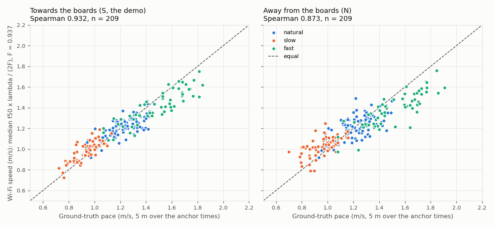
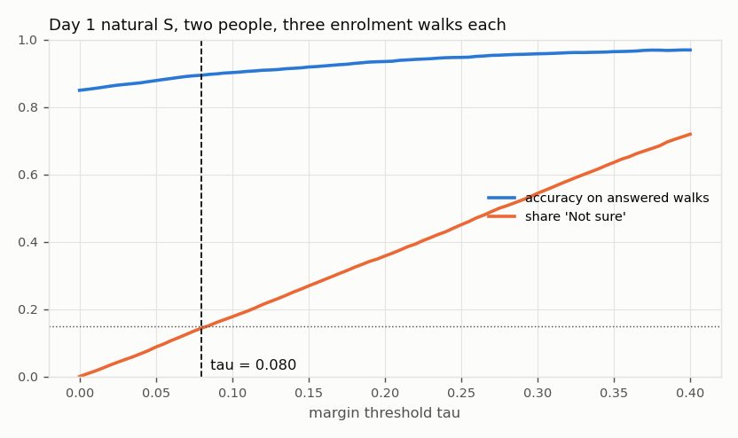

# Offline evaluation, 28 October 2026

Room B identification walks, RX2 only (0.5 m beside the TX, the demo geometry), 418 unflagged passes, every one streamed through the live app's causal chain. CPU 42 s.

## Headline

- **Speedometer:** S-pass Spearman **0.932** (n = 209), extractor A with nfft 128. Above the 0.5 bar; the thesis measured 0.744 on RX2 with a different extractor.
- **Two people, three walks each:** within day 1 **85.0 ± 1.5 %**, within day 2 87.2 ± 3.4 %, cross-day (day 2 natural) 48.7 ± 3.3 %. Chance is 50 %.
- **Speed alone** gets 71.6 % within day 1. Within a day the extra features add +13.3 points over speed alone (steps adds nothing: leaving it out changes accuracy by +0.8; swing helps: leaving it out changes accuracy by -1.3; bounce helps: leaving it out changes accuracy by -9.1). Across days they change accuracy by -13.4 points: speed holds up across days and the gait features do not, so the within-day figure is the upper end for a stale pool.
- **Not sure threshold:** tau = **0.080** (at most 15 % not sure within day 1).

prior_sd and tau are fitted on the day-1 natural S walks by design, and the within-day-1 accuracy is measured on the same walks; prior_sd only floors the spread, tau only sets the not sure share.

**Caveat.** Within-day results are optimistic: each person's passes were one contiguous recording block (the thesis's recording-block confound), so a feature can tell blocks apart rather than people. Cross-day results are pessimistic: everything about the room and the person's day has changed. The live demo, with both people enrolled within the same few minutes, sits between the two.

## 1. Speedometer

Doppler speed = median over active columns of f50 x lambda / (2F). Ground truth = 5 m over (last anchor - first anchor). Variants compared at F = 1, active threshold k = 6.0 x the baseline's median energy (smoothed over 5 columns).

| extractor | S Spearman | S Pearson | S median abs err (m/s) | S bias (m/s) | N Spearman | S walks seen |
|---|---|---|---|---|---|---|
| A nfft 128 **(chosen)** | 0.932 | 0.940 | 0.079 | -0.073 | 0.873 | 100 % |
| A nfft 64 | 0.932 | 0.941 | 0.073 | -0.069 | 0.873 | 100 % |
| B nfft 128 | 0.928 | 0.927 | 0.043 | -0.016 | 0.887 | 60 % |
| B nfft 64 | 0.920 | 0.915 | 0.049 | -0.014 | 0.887 | 62 % |

A = PCA across subcarriers (2 s window, refit every 0.5 s), PC1 dropped, PCs 2-4 kept. B = power summed over all 103 live subcarriers.

Chosen extractor by subset (F = 1):

| direction | day | block | n | Spearman | Pearson | median abs err | bias |
|---|---|---|---|---|---|---|---|
| S | 1 | all | 120 | 0.911 | 0.927 | 0.077 | -0.073 |
| S | 1 | natural | 60 | 0.640 | 0.746 | 0.079 | -0.077 |
| S | 1 | slow | 30 | 0.725 | 0.785 | 0.055 | -0.048 |
| S | 1 | fast | 30 | 0.849 | 0.874 | 0.126 | -0.126 |
| S | 2 | all | 89 | 0.955 | 0.954 | 0.080 | -0.072 |
| S | 2 | natural | 30 | 0.836 | 0.851 | 0.098 | -0.098 |
| S | 2 | slow | 30 | 0.875 | 0.854 | 0.037 | 0.012 |
| S | 2 | fast | 29 | 0.901 | 0.891 | 0.175 | -0.175 |
| N | 1 | all | 120 | 0.866 | 0.900 | 0.084 | -0.072 |
| N | 1 | natural | 60 | 0.468 | 0.604 | 0.083 | -0.071 |
| N | 1 | slow | 30 | 0.697 | 0.663 | 0.055 | -0.007 |
| N | 1 | fast | 30 | 0.915 | 0.900 | 0.170 | -0.170 |
| N | 2 | all | 89 | 0.879 | 0.877 | 0.123 | -0.108 |
| N | 2 | natural | 30 | 0.676 | 0.696 | 0.104 | -0.096 |
| N | 2 | slow | 30 | 0.640 | 0.600 | 0.061 | -0.005 |
| N | 2 | fast | 29 | 0.804 | 0.826 | 0.249 | -0.249 |

**Calibration.** At F = 1 the readout runs slow (S bias -0.073 m/s). Fitting F on day 1 S passes gives F = 0.937; with it, day 2 S passes have median absolute error 0.063 m/s and bias -0.001 m/s (held out). F = 0.937 (all S passes) is written to the config, so the on-screen speed reads true in this geometry. Spearman does not depend on F.

**How the offline walks end** (S passes): 201 at the stop line (last anchor), 8 at the 6 s limit. Each pass is one continuous stretch of its own recording; the window closes at the last anchor because the Room B walkers turned round there rather than standing still, so the live 'stopped on quiet' rule cannot be exercised offline.

**Active threshold.** Clicks on an empty room (floor from the first half of each empty_idspot recording, a click every second in the second half) show whether noise alone makes a walk:

| k | S Spearman | S walks seen | empty-room false walks |
|---|---|---|---|
| 3 | 0.935 | 100 % | 10 of 108 |
| 4 | 0.934 | 100 % | 5 of 108 |
| 6 (config) | 0.932 | 100 % | 0 of 108 |
| 8 | 0.931 | 100 % | 0 of 108 |
| 12 | 0.920 | 99 % | 0 of 108 |

## 2. Feature quality (day 1 natural, S passes)

| feature | within-person SD | between-person SD | between / within | per-person means |
|---|---|---|---|---|
| speed | 0.06095 | 0.09274 | 1.52 | P1 1.2, P2 1.22, P3 1.24, P4 1.02, P5 1.2, P6 1.29 |
| steps | 20.31 | 5.954 | 0.29 | P1 107, P2 113, P3 115, P4 108, P5 98.2, P6 110 |
| swing | 0.1774 | 0.1852 | 1.04 | P1 2.08, P2 2.07, P3 2.03, P4 2.19, P5 1.69, P6 1.82 |
| bounce | 0.0444 | 0.07204 | 1.62 | P1 0.268, P2 0.267, P3 0.222, P4 0.321, P5 0.129, P6 0.162 |

prior_sd is set to the within-person SDs: speed 0.0609, steps 20.3, swing 0.177, bounce 0.0444. Step rate has no ground truth; it is the weakest feature (ratio 0.29) and 0 S walks gave no step-rate peak. Speed's within-person SD is in calibrated m/s.

## 3. Two-person accuracy

All 15 pairs of the six participants, 50 random draws; per draw, random enrolment walks (S natural, day 1 unless stated) and every remaining S walk of both as tests. Mean ± SD over draws. 'Forced' always names the nearer person; 'with tau' counts not sure as a miss, as the tally does.

| condition | tests per draw | four features (forced) | speed only (forced) | with tau | not sure |
|---|---|---|---|---|---|
| Within day 1 (natural) | 210 | 85.0 ± 1.5 % | 71.6 ± 2.6 % | 76.6 ± 2.2 % | 14 % |
| Within day 2 (natural) | 60 | 87.2 ± 3.4 % | 74.7 ± 4.5 % | 79.3 ± 4.0 % | 14 % |
| Cross-day: enrol day 1, test day 2 natural | 150 | 48.7 ± 3.3 % | 62.1 ± 5.0 % | 35.2 ± 3.1 % | 27 % |
| Cross-day: enrol day 1, test day 2 slow | 150 | 49.9 ± 1.6 % | 52.0 ± 0.9 % | 38.9 ± 2.5 % | 24 % |
| Cross-day: enrol day 1, test day 2 fast | 145 | 52.5 ± 2.5 % | 57.9 ± 1.3 % | 36.1 ± 2.8 % | 34 % |

Enrolment size (within day 1, forced):

| walks each | tests per draw | four features | speed only |
|---|---|---|---|
| 1 | 270 | 79.0 ± 2.8 % | 68.2 % |
| 2 | 240 | 82.9 ± 2.0 % | 70.1 % |
| 3 | 210 | 85.0 ± 1.5 % | 71.6 % |
| 5 | 150 | 86.0 ± 1.7 % | 73.0 % |

Each feature left out once (within day 1, three walks each, forced):

| left out | accuracy | change |
|---|---|---|
| speed | 78.5 ± 1.9 % | -6.4 points |
| steps | 85.7 ± 1.3 % | +0.8 points |
| swing | 83.7 ± 1.6 % | -1.3 points |
| bounce | 75.8 ± 2.2 % | -9.1 points |

**Do the extra features earn their place?** Four features 85.0 %, speed alone 71.6 % within day 1. Within a day the extra features add +13.3 points over speed alone (steps adds nothing: leaving it out changes accuracy by +0.8; swing helps: leaving it out changes accuracy by -1.3; bounce helps: leaving it out changes accuracy by -9.1). Across days they change accuracy by -13.4 points: speed holds up across days and the gait features do not, so the within-day figure is the upper end for a stale pool. The decision uses classifier.use (speed, steps, swing, bounce); the tiles always show all four.

## 4. Not sure threshold

Margin = (d_far - d_near) / (d_far + d_near). tau is the value that maximises accuracy on answered walks with at most 15 % not sure, within day 1: **tau = 0.080**.

| tau | not sure | accuracy on answered | right overall |
|---|---|---|---|
| 0.000 | 0 % | 85.0 % | 85.0 % |
| 0.020 | 3 % | 86.2 % | 83.2 % |
| 0.040 | 7 % | 87.2 % | 81.3 % |
| 0.060 | 11 % | 88.5 % | 79.0 % |
| 0.080 | 14 % | 89.4 % | 76.6 % |
| 0.100 | 18 % | 90.2 % | 74.2 % |
| 0.120 | 21 % | 90.9 % | 71.4 % |
| 0.140 | 25 % | 91.5 % | 68.5 % |
| 0.160 | 29 % | 92.2 % | 65.7 % |
| 0.180 | 32 % | 92.9 % | 62.8 % |
| 0.200 | 36 % | 93.5 % | 60.0 % |
| 0.220 | 39 % | 94.1 % | 57.1 % |
| 0.240 | 43 % | 94.6 % | 53.9 % |
| 0.260 | 47 % | 95.0 % | 50.3 % |
| 0.280 | 51 % | 95.5 % | 47.1 % |
| 0.300 | 54 % | 95.8 % | 43.7 % |
| 0.320 | 58 % | 96.1 % | 40.3 % |
| 0.340 | 62 % | 96.2 % | 36.9 % |
| 0.360 | 65 % | 96.5 % | 33.6 % |
| 0.380 | 68 % | 96.9 % | 30.5 % |
| 0.400 | 72 % | 96.9 % | 27.2 % |

## 5. Timing

- Chain, live-like batches of 8 packets: 0.38 ms per column (one column per 53 ms), 0.81 ms per batch at p95, 0.83 ms at most.
- End-of-walk decision latency: the deciding column is out 127 ms after its last sample (half the STFT window plus the Hampel delay), plus up to 53 ms waiting for a batch, plus 0.2 ms for the features and the decision: **180 ms** (target under 500 ms). The walk itself is only declared over after 0.5 s of quiet, and the 'Reading the echo...' view then shows for 0.7 s by design.
- Whole evaluation: 42 s CPU, 43 s wall.

